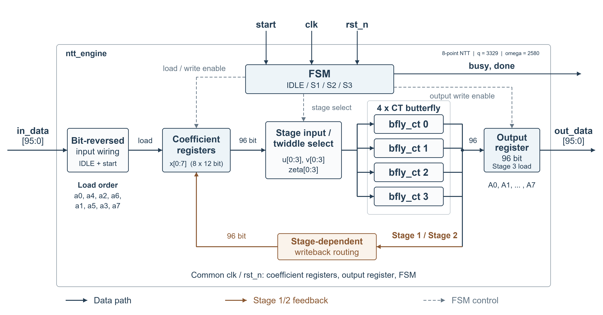
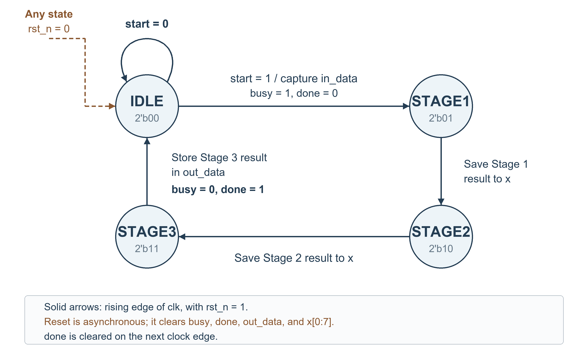

# HW2: 8-point forward NTT

System IC Design 과제에서 구현한 8-point forward NTT engine이다.
HW1의 modular arithmetic 모듈과 CT butterfly를 재사용하고,
4개의 butterfly로 세 stage를 순차 처리한다.

## 설계

| 항목 | 내용 |
| --- | --- |
| Top module | `ntt_engine` |
| Modulus / root of unity | q = 3329 / omega = 2580 |
| 입출력 | unsigned 12-bit 계수 8개를 묶은 96-bit bus |
| Datapath | CT butterfly 4개, 중간 결과 register, 별도 출력 register |
| FSM | IDLE → STAGE1 → STAGE2 → STAGE3 → IDLE |
| Latency | 입력 수락 이후 3 clock |
| Reset | Active-low asynchronous reset |

입력을 수락한 뒤에는 외부 입력 변경과 busy 중 추가 start를 무시한다.
완료 시 done을 1 clock 동안 출력하고, 계산 결과는 다음 완료 또는 reset까지 유지한다.





## 파일 구성

```text
HW2/
├── README.md
├── rtl/
│   ├── ntt_engine.v
│   ├── bfly_ct.v, mod_add.v, mod_sub.v, mod_mul.v
│   ├── tb_hw2.v
│   ├── golden_model.py
│   ├── run_sim.do
│   ├── vectors/
│   └── sim_results/
├── scripts/ntt_syn.tcl
├── run_synth.sh
├── outputs/
├── reports/
└── docs/
```

`rtl/`에는 simulation에 필요한 코드와 데이터가 함께 있다.
합성 Tcl은 이 중 RTL 5개만 읽으며, Testbench는 합성하지 않는다.

## RTL simulation

Python 3과 ModelSim을 사용한다. Golden model은 Python 표준 라이브러리만 사용한다.
저장소 최상위에서 다음과 같이 실행한다.

```sh
cd HW2/rtl
vsim -c -do run_sim.do
```

ModelSim GUI에서는 `HW2/rtl`을 작업 폴더로 설정하고 Transcript에 입력한다.

```tcl
do run_sim.do
```

Script가 Golden model로 vector를 생성하고, RTL과 Testbench를 compile한 뒤
simulation을 수행한다. 실행 결과는 `rtl/sim_results/`에 저장되며 기존 파일은 갱신된다.
ModelSim의 `work/`, `modelsim.ini`, `transcript`, WLF 파일은 실행 시 생성된다.

## 검증 결과

| 항목 | 결과 |
| --- | ---: |
| 서로 다른 입력 | 제공 입력 5개를 포함한 20개 |
| 기능 검증 | 20/20 PASS |
| 제어 시나리오 | 11/11 PASS |
| 요청 수락 / 완료 / reset 취소 | 32 / 29 / 3 |
| 검사 조건 평가 / 실패 | 2498 / 0 |
| Compile error / warning | 0 / 0 |
| Simulation error / warning | 0 / 0 |

Golden model은 NTT 정의식을 직접 계산한다. 제어 검증에서는 입력 저장,
추가 start 무시, done pulse, 출력 유지, reset에 의한 취소와 복구를 확인했다.

- [입력별 기대 출력과 실제 출력](rtl/sim_results/functional_results.csv)
- [제어 시나리오 결과](rtl/sim_results/control_results.log)
- [Simulation 실행 로그](rtl/sim_results/simulation.log)

## Synthesis

Linux 환경의 Synopsys Design Compiler와 강의용 SAED 32 nm library를 사용한다.
저장소 최상위에서 실행한다.

```sh
cd HW2
bash run_synth.sh
```

Library가 script의 기본 검색 경로에 없으면 실제 `.db` 파일 위치를 지정한다.

```sh
export SAED32_DB=/path/to/saed32rvt_ff1p16v125c.db
bash run_synth.sh
```

Library 파일 자체는 포함하지 않았다. 작업 폴더 `work/`는 script가 생성하며,
합성 결과는 `outputs/`와 `reports/`에 저장한다.

| 항목 | 결과 |
| --- | --- |
| Tool | Design Compiler Q-2019.12-SP5-5 |
| Library | saed32rvt_ff1p16v125c.db |
| Clock constraint | 5.00 ns (200 MHz) |
| Synthesis command | 옵션 없는 `compile` |
| Setup slack | +1.30 ns, MET |
| Total cell area | 14,402.340340 µm² |
| Sequential cell / latch | 196 / 0 |

Timing은 해당 library와 clock constraint에서 내부 register-to-register 경로의
setup 분석 결과다. 외부 I/O delay는 설정하지 않았으며, area는 wire-load 기반
합성 결과다. Place-and-route, gate-level simulation, formal equivalence는 수행하지 않았다.

- [Timing report](reports/ntt_engine.mapped.timing.rpt)
- [Area report](reports/ntt_engine.mapped.area.rpt)
- [합성된 gate-level netlist](outputs/ntt_engine_mapped.v)
- [SDC](outputs/ntt_engine.sdc)

## 보고서

[최종 보고서 PDF](docs/2022142233_%EC%9D%B4%EC%9A%B0%ED%98%84_HW%232.pdf)

설계 구조, 전체 입력별 비교, 대표 파형과 timing·area 분석을 정리했다.
